 

Hey, I'm Ima 👋 I make Android apps and mess around with custom ROMs for Pixel phones.

I like building things that feel nice to use and don't ask for anything back. Private, offline, made with care, the way I'd want an app to be. If one of them helped you even a little, that already made my day. A ⭐ on a repo goes a long way too.

## $ ls projects/

<table>
<tr>
<td width="50%" valign="top">

### 🌙 [ALMA](https://github.com/JH3RSON/ALMA)

An offline personal journal for Android. Your thoughts stay on your device, with smooth animations and local document export. Open source.

</td>
<td width="50%" valign="top">

### ⬇️ [ImaLoader-Android](https://github.com/JH3RSON/ImaLoader-Android)

Download media in the background and keep your storage under control, without the hassle.

v3.0 is on its way.

</td>
</tr>
</table>

## $ ls roms/

Custom ROM support for Google Pixel. Device trees for **Pantah** and **Cheetah**, built for EvolutionX and LineageOS:

- [android_device_google_pantah_ima_evox](https://github.com/JH3RSON/android_device_google_pantah_ima_evox)
- [android_device_google_cheetah_ima_evolutions](https://github.com/JH3RSON/android_device_google_cheetah_ima_evolutions)

## $ cat stack.txt

## $ git log --stat

## $ ./contact.sh

Something broke, or something feels off? Write to me on Telegram, I read everything. And if my apps made your day a little easier, you can buy me a coffee. It helps me keep going, but it's never expected.

🐭

